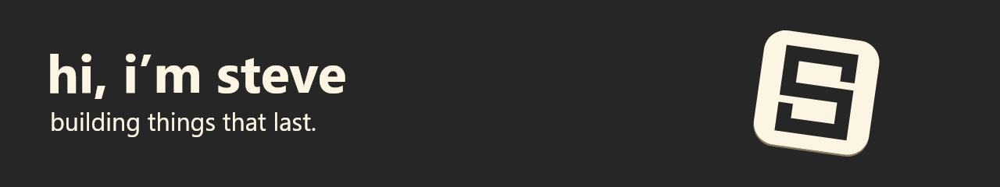

<picture>
  <source media="(prefers-reduced-motion: reduce)" srcset="assets/banner-steve-3d.png">
  
</picture>

<picture>
  <source media="(prefers-color-scheme: dark)" srcset="assets/typing-dark.svg">
  
</picture>

Self taught engineer. Always learning. Thinking from first principles, finding root causes, and building reusable solutions.

Writing [**The Fool’s Notebook**](https://itsstevezhu.com/blog/) on product, engineering, philosophy, and the questions in between.

- [Atom Harness](https://github.com/sz-747/atom-harness): a calm harness for working with coding agents.
- [OpenHSC](https://github.com/sz-747/OpenHSC): open-source AI skills for the NSW Higher School Certificate.
- [Utter](https://github.com/sz-747/utter-public): private, on-device dictation for Windows. Press a shortcut, speak, and the text is typed where your cursor is.

### Across the workbench

`TypeScript` · `JavaScript` · `Python` · `Go` · `Rust` · `C#` · `PL/pgSQL` · `HTML` · `CSS` · `PowerShell` · `Shell`

### How I build

`Context engineering` · `Agent orchestration` · `Systems thinking` · `Product experimentation`

The agent skills I use are collected in my [**skills registry**](https://skills.itsstevezhu.com).

### Growing with the work

A LITTLE GROWTH, EVERY DAY.

Bonsai by <a href="https://github.com/egorthinks/git-bonsai">Git Bonsai</a> · Animation by <a href="https://github.com/DenverCoder1/readme-typing-svg">Readme Typing SVG</a>

### Find me

- [X](https://x.com/stevez747): memos and thoughts along the way.
- [GitHub](https://github.com/sz-747): projects and code.
- [The Fool’s Notebook](https://itsstevezhu.com/blog/): writing on product, engineering, philosophy, and more.
