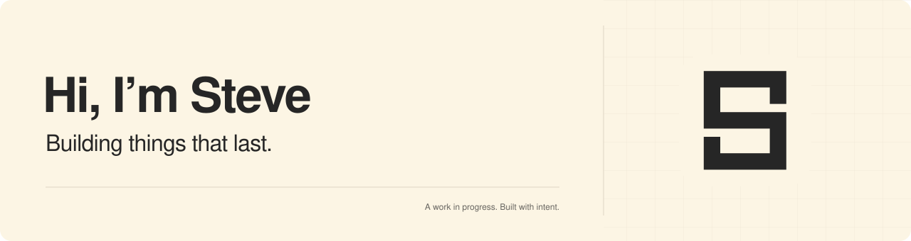

<picture>
  <source media="(prefers-color-scheme: dark)" srcset="assets/hero-dark.svg">
  
</picture>

<picture>
  <source media="(prefers-color-scheme: dark)" srcset="assets/typing-dark.svg">
  
</picture>

Self taught engineer. Always learning. Thinking from first principles, finding root causes, and building reusable solutions.

Writing [**The Fool’s Notebook**](https://itsstevezhu.com/blog/) on product, engineering, philosophy, and the questions in between.

[GitHub projects →](https://github.com/sz-747?tab=repositories)

### Selected projects

Much of my current work is still in R&D and lives in private repositories.

<table>
<tr>
<td width="50%" valign="top">
<h3><a href="https://github.com/sz-747/atom-harness">Atom</a></h3>

A calm coding-agent harness that makes model capability easier to see, compare, and measure.

</td>
<td width="50%" valign="top">
<h3><a href="https://github.com/sz-747/OpenHSC">OpenHSC</a></h3>

Open-source AI skills for the NSW Higher School Certificate.

</td>
</tr>
<tr>
<td colspan="2" valign="top">
<h3><a href="https://github.com/sz-747/skillify">Skillify</a></h3>

A practical standard for writing agent skills around outcomes, clear structure, and source-backed guidance.

</td>
</tr>
</table>

### Across the workbench

`TypeScript` · `JavaScript` · `Python` · `Go` · `Rust` · `C#` · `PL/pgSQL` · `HTML` · `CSS` · `PowerShell` · `Shell`

### How I build

`Context engineering` · `Agent orchestration` · `Systems thinking` · `Product experimentation`

### Growing with the work

A LITTLE GROWTH, EVERY DAY.

Bonsai by <a href="https://github.com/egorthinks/git-bonsai">Git Bonsai</a> · Animation by <a href="https://github.com/DenverCoder1/readme-typing-svg">Readme Typing SVG</a>

### Find me

- [X](https://x.com/stevez747): memos and thoughts along the way.
- [GitHub](https://github.com/sz-747): projects and code.
- [The Fool’s Notebook](https://itsstevezhu.com/blog/): writing on product, engineering, philosophy, and more.
